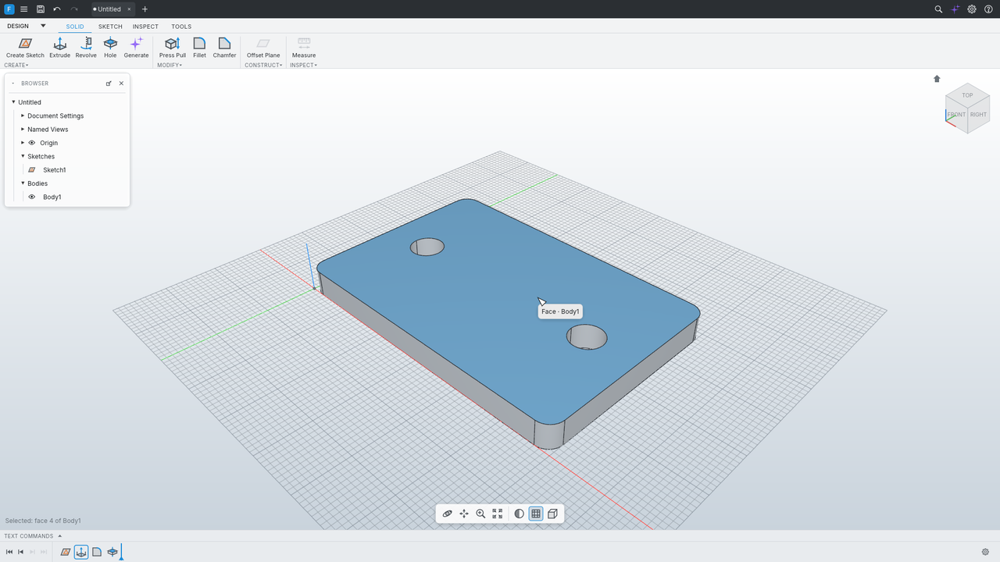

# FormCraft

Параметрическая 3D CAD на Rust с интерфейсом в духе Fusion 360, локальным ИИ-ассистентом,
плагинами на WebAssembly и скриптами на Python. Всё работает офлайн.



- **Моделирование:** эскизы с решателем ограничений, выдавливание, вращение, отверстия
  (цековка, зенковка), скругления, фаски, оболочка, Press Pull, булевы операции; таймлайн с
  маркером отката, параметры и выражения (`L*2`, единицы, функции), отмена/повтор.
- **Ядро:** OpenCascade 7.8 (через собственную C++-обвязку с перехватом исключений).
- **Файлы:** `.fcraft` (документ), STEP (экспорт и импорт как базовое тело), STL, 3MF.
- **Inspect:** измерение, сечение, свойства и масса по материалу.
- **ИИ:** «опиши деталь словами» → группа фич на таймлайне (превью, Принять/Отклонить, один шаг
  отмены). Локальная модель через Ollama или любой OpenAI-совместимый сервер.
- **Расширения:** Add-Ins (WebAssembly-компоненты в песочнице, свои команды и параметрические
  фичи), скрипты на Python через control channel, MCP-сервер для внешних агентов, CLI.

## Сборка

Нужны Rust ≥ 1.95 (rustup), CMake, C++-компилятор (Windows: Visual Studio Build Tools с
«Desktop development with C++»; Linux: `build-essential clang cmake` и dev-пакеты из
[docs/environment.md](docs/environment.md)).

```bash
cargo build --release -p formcraft -p formcraft-cli
```

Первая сборка компилирует OpenCascade (30–60 минут), дальше — инкрементально. Проверка всего
проекта: `cargo xtask ci` (fmt, clippy, тесты, слои, лицензии).

> Windows: путь к репозиторию может содержать кириллицу, но FreeCADCmd и `ollama create -f`
> её не понимают — для них используйте ASCII-папки (см. `docs/environment.md`).

## Запуск

```bash
target/release/formcraft                         # приложение
target/release/formcraft --script examples/bracket.fcs
target/release/formcraft-cli run examples/bracket.fcs --save bracket.step
target/release/formcraft-cli convert part.step part.3mf
target/release/formcraft-cli render examples/golden/flange.fcs flange.png --view iso
target/release/formcraft-cli commands            # все команды с JSON-схемами
```

Горячие клавиши в духе Fusion — [docs/shortcuts.md](docs/shortcuts.md): S — поиск команд (и ИИ),
E — выдавить, L/R/C/D в эскизе, F — скругление, H — отверстие, Shift+S — Scripts and Add-Ins,
правая кнопка — marking menu.

## ИИ-ассистент (Ollama)

1. Установите [Ollama](https://ollama.com) и запустите `ollama serve` (адрес по умолчанию
   `http://127.0.0.1:11434`).
2. Загрузите модель по умолчанию: `ollama pull qwen2.5-coder:7b`
   (альтернатива — `qwen3:8b`; выбор и замеры — [ADR 0005](docs/adr/0005-default-model.md)).
   Если `pull` не работает из-за прокси, скачайте GGUF с Hugging Face и создайте модель из
   `models/*.Modelfile` (`ollama create qwen2.5-coder:7b -f models/qwen2.5-coder-7b.Modelfile`).
3. В приложении: клавиша **S** → введите описание → «✦ Сделать с ИИ», или кнопка
   **Generate** на вкладке Solid, или ✦ в правом верхнем углу (панель Assistant).
   Из командной строки: `formcraft-cli ai "фланец Ø100, 4 отверстия Ø9 на Ø80, толщина 10"`.

Настройка: `FORMCRAFT_AI_MODEL`, `FORMCRAFT_AI_URL`, `FORMCRAFT_AI_BACKEND=openai` (llama.cpp
`llama-server`, LM Studio) — или в настройках приложения. Модель работает на GPU, если Ollama его
видит; на CPU генерация занимает минуты. Качество модели меряет `cargo xtask ai-bench`
(50 деталей с эталонами).

## Add-Ins и скрипты

```bash
formcraft --plugin examples/plugins/gear         # загрузить add-in из папки
formcraft-cli plugin install gear.zip            # установить в %APPDATA%/FormCraft/plugins
formcraft-cli plugin new my_addin --lang rust    # шаблон add-in (собирается под wasm32-wasip2)
python examples/scripts/export_stl.py C:/out     # скрипт против `formcraft --control 7878`
```

Руководство: [docs/plugins/README.md](docs/plugins/README.md). Примеры: «Шестерня»
(`examples/plugins/gear`, параметрическая фича), «Масса по таблице материалов»
(`examples/plugins/material`), пакетный экспорт STL (`examples/scripts/export_stl.py`).

## MCP

`formcraft-cli mcp` — MCP-сервер по stdio (инструменты `execute`, `inspect_model`, `render`,
`list_commands`, `list_selectors`, `run_script`; с `--port N` — подключение к запущенному
приложению `formcraft --control N`, плюс `screenshot` и `ui_click`). В репозитории есть
`.mcp.json` для Claude Code (`cargo xtask mcp-install` кладёт бинарник в `target/mcp/`).

## Документация

- [PLAN.md](PLAN.md) — план и фазы, [UI_SPEC.md](UI_SPEC.md) — внешний вид,
  [PROGRESS.md](PROGRESS.md) — состояние и итоговый отчёт.
- [docs/architecture.md](docs/architecture.md) — слои крейтов; [docs/adr/](docs/adr/) — решения.
- [docs/learn/](docs/learn/) — объяснения по фазам для тех, кто изучает код.

## Лицензии

Код FormCraft — MIT OR Apache-2.0. Зависимости — MIT/Apache-2.0/BSD-подобные; OpenCascade —
LGPL-2.1 (только ядро, ADR 0002); шрифт Inter — SIL OFL 1.1. См. [ATTRIBUTION.md](ATTRIBUTION.md).
Интерфейс повторяет раскладку и логику Fusion 360, но иконки, тексты и ресурсы — свои.
